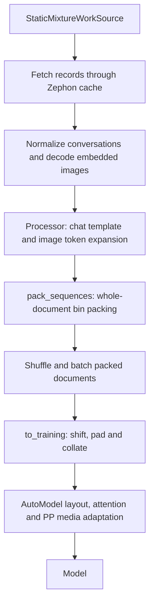

[Zephon](https://zephon.io/) turns datasets into training batches. You choose
the sources, their mixture and how to prepare documents; Zephon handles reading,
packing and replay. AutoModel supplies the model and training loop.

This guide covers the AutoModel settings you need to get started. The
[Zephon User Guide (ZUG)](https://docs.zephon.io/) explains the underlying
concepts and APIs in more detail.

## Start with a recipe

Follow the [AutoModel installation guide](/get-started/installation); Zephon is
included in the dependencies. Choose a recipe for your model and input:

| Model | Text: tokenize and pack online | Text: already packed | Instruction SFT |
| --- | --- | --- | --- |
| Qwen3 0.6B | [Online](https://github.com/NVIDIA-NeMo/Automodel/blob/main/examples/llm_pretrain/qwen/zephon.yaml) | [Prepacked](https://github.com/NVIDIA-NeMo/Automodel/blob/main/examples/llm_pretrain/qwen/zephon_prepacked.yaml) | [SFT](https://github.com/NVIDIA-NeMo/Automodel/blob/main/examples/llm_finetune/qwen/zephon.yaml) |
| Llama 3.2 1B | [Online](https://github.com/NVIDIA-NeMo/Automodel/blob/main/examples/llm_pretrain/llama3_2/zephon.yaml) | [Prepacked](https://github.com/NVIDIA-NeMo/Automodel/blob/main/examples/llm_pretrain/llama3_2/zephon_prepacked.yaml) | [SFT](https://github.com/NVIDIA-NeMo/Automodel/blob/main/examples/llm_finetune/llama3_2/zephon.yaml) |

For example, run from the repository root:

```bash
uv run automodel examples/llm_pretrain/qwen/zephon.yaml --nproc-per-node 8
```

The online recipes mix web, code and arXiv documents; prepacked recipes need
your prepared tokens. Check the recipe's process count and training budget,
and obtain access to gated checkpoints before running.

## Datasets, work sources and pipelines

There are three parts to a Zephon data-loading setup:

- A **dataset** describes stored documents and their shards. A source `path`
  can point to a local dataset directory, object storage or Hugging Face, such
  as `hf://org/dataset/subset/train`. Zephon discovers the shard format;
  set `fmt` only when an override is needed.
- A **work source** chooses which documents the pipeline processes, in what
  order and from which datasets. A `StaticMixtureWorkSource` uses your source
  weights to define the requested mixture.
- A **pipeline** prepares those documents using **operators**, such as fetching,
  tokenizing, packing and batching. AutoModel constructs the pipeline from
  your recipe.

See [datasets and storage](https://docs.zephon.io/datasets/storage_backends_and_shard_cache.html),
[mixing datasets](https://docs.zephon.io/worksources/mixing_datasets.html) and
[pipelines](https://docs.zephon.io/pipelines/index.html) in the ZUG.

## Choose your input

Set `dataset._target_` to the config for your documents. AutoModel selects the
matching Zephon loader when you omit `dataloader._target_`.

| Input | Dataset config | Preparation during training |
| --- | --- | --- |
| Raw text | `ZephonTextDatasetConfig` | Tokenize, then optionally pack |
| Pretokenized documents | `ZephonPretokenizedTextDatasetConfig` | Optionally pack; keep supplied token IDs |
| Prepacked tokens | `ZephonPretokenizedTextDatasetConfig` | Set `packing.pack_algorithm: null` to preserve each pack |
| Instructions | `ZephonInstructionDatasetConfig` | Chat tokenize and optionally pack |
| Image conversations | `ZephonVlmDatasetConfig` | Apply the processor and pack whole documents |

### Raw text and source mixtures

For JSONL or Parquet documents with a `text` field, configure sources under
`dataset.zephon`. For example:

```yaml
dataset:
  _target_: nemo_automodel.components.datasets.zephon.ZephonTextDatasetConfig
  tokenize_special_tokens: eos
  zephon:
    sources:
    - {name: web, path: /data/web, weight: 0.7}
    - {name: code, path: /data/code, weight: 0.3}
    packing:
      seq_len: 2048
    checkpoint:
      run_id: web-code-training
```

Each path identifies a dataset directory containing shards. Use `text_field`
if your text column has another name. `tokenize_special_tokens` selects BOS/EOS
insertion; the example appends EOS to each document. Use the tokenizer that
belongs to the model you are training.

**Token-aware mixing.** A 70/30 mixture of long web documents and short code
snippets does not give a 70/30 token mixture when sampling by document count.
For multi-source text, AutoModel enables Zephon's token estimation by default:
it measures a subset of each source with the training tokenizer and adjusts
sampling to approximate your requested token proportions. This also applies to
instruction data and pretokenized text. Weights are relative and do not need to sum to one.
Set `dataset.zephon.source.token_estimation: false` for document-count mixing.
Dropping documents later can change the final token mixture; estimation is
not a guarantee of exact output proportions. See the
[mixing guide](https://docs.zephon.io/worksources/mixing_datasets.html) for calibration.

For a single source, `dataset.path_or_dataset_id` or `dataset.paths` is also
accepted in place of `zephon.sources`. Use a dataset root or a Hugging Face ID
with `name`/`split`. Use explicit `zephon.sources` for mixtures; the two source
declaration styles cannot be combined.

### Use pretokenized and prepacked text

Use `ZephonPretokenizedTextDatasetConfig` when tokenization happened offline.
Supply **unshifted, unpadded** token lists made with the exact model tokenizer.
`tokens_field` defaults to `input_ids`; `loss_mask_field` defaults to `loss_mask`.
The optional loss mask is token-aligned and binary. Zephon handles the
next-token shift and padding during training; do not store shifted labels.

Leave online packing enabled to combine tokenized documents, or set
`dataset.zephon.packing.pack_algorithm: null` for prepacked input. Each stored
sequence must then have at most `seq_len + 1` tokens: a 1,024-token model input
needs up to 1,025 unshifted tokens. Longer sequences are rejected.

Prepacked sequences can carry Zephon's `positions` field to retain subdocument
boundaries. Without it, each stored sequence is one document, even if it
contains EOS tokens. Supplied positions require online packing to be disabled.
See [packing](https://docs.zephon.io/pipelines/packing.html) and
[building training batches](https://docs.zephon.io/pipelines/building_training_batches.html)
for the Zephon formats. The prepacked recipes above show the complete AutoModel
configuration and local input paths.

### Instruction tuning

Use `ZephonInstructionDatasetConfig` for instruction SFT. Map your columns and
select the model's chat template:

```yaml
dataset:
  _target_: nemo_automodel.components.datasets.zephon.ZephonInstructionDatasetConfig
  path_or_dataset_id: yahma/alpaca-cleaned
  column_mapping: {context: input, question: instruction, answer: output}
  use_hf_chat_template: true
```

With `use_hf_chat_template: true`, the tokenizer must provide a chat template;
it owns conversation formatting and special tokens. For plain prompt/completion
formatting, set it to `false`. `answer_only_loss_mask` defaults to `true`;
set it to `false` to supervise all tokens. Tokenization and loss masking use
Zephon's built-in `tokenize_chat()`. The example recipes use `best_fit` to pack
whole conversations. See [preparing samples](https://docs.zephon.io/pipelines/preparing_samples.html).

To reuse an existing `ColumnMappedTextInstructionDatasetConfig`, select
`dataloader._target_` as
`nemo_automodel.components.datasets.zephon.ZephonDataloaderConfig`. This accepts
supported source and formatting settings; disable native padding, truncation
and sample limits. Use the Zephon dataset config for `dataset.zephon` options.

### Image instruction tuning

Use `ZephonVlmDatasetConfig` for image SFT. The image recipes read
[MedPix-VQA](https://huggingface.co/datasets/mmoukouba/MedPix-VQA), mapping its
`image_id` column to the image input:

| Model | Recipe |
| --- | --- |
| Qwen3-VL-2B-Instruct | [Qwen](https://github.com/NVIDIA-NeMo/Automodel/blob/main/examples/vlm_finetune/qwen3/zephon.yaml) |
| Gemma4-31B-it | [Gemma](https://github.com/NVIDIA-NeMo/Automodel/blob/main/examples/vlm_finetune/gemma4/zephon.yaml) |
| Ministral3-3B-Instruct-BF16 | [Ministral](https://github.com/NVIDIA-NeMo/Automodel/blob/main/examples/vlm_finetune/mistral/zephon.yaml) |

All three recipes use eight processes and retain their model/backend settings.
Gemma uses the supported dense 31B architecture.
Configure the processor under `processor` and an optional template under
`dataset.chat_template`.

Supply self-contained Parquet or LitData records with conversations and
embedded image bytes. Export path/URL-only data first so Zephon can own
downloads, caching and eviction. See the
[image data guide](/datasets/zephon-images) for schemas, per-source
`input.column_mapping` and the offline export tool.

Image conversations are prepared and packed online with `first_fit` (the
default) or `best_fit`; wrapping, unpacked and prepacked image inputs are not
supported. The packed length includes expanded image tokens. Assistant tokens
are supervised. Image mixtures use document-count weights; media-aware token
estimation is unsupported. Use batched output for VLM PP; THD image output
also requires `dataset.zephon.inject_fake_images: false`. Video and audio are unsupported.

## Packing and attention

All settings below are under `dataset.zephon`:

- `packing.seq_len` is the model input-token limit for a packed document. If
  omitted, it uses the model's context limit. Set a shorter window when needed;
  values above a known model limit are rejected.
- `packing.pack_algorithm` defaults to `wrap` for text. It fills sequences and
  can split documents. Use `first_fit` or `best_fit` to keep documents whole,
  or `null` to disable online text packing. Whole-document packing drops
  oversized documents by default; set `drop_oversized: false` to raise instead.
- `training.allow_cross_document_attention` defaults to `false`: subdocuments
  within a pack cannot attend to one another. Set it to `true` to allow causal
  attention across their boundaries. Positions reset with isolation and run
  continuously when joined. Separate packed documents in a batch stay independent.
- `training.mask_segment_starts` independently controls loss at subdocument
  boundaries. Its default, `false`, allows those next-token targets; `true`
  excludes them.

Packing does not select an attention backend. Keep the backend under
`model.attn_implementation`. `dataset.output_format` defaults to `batched`;
choose `thd` only for a model/backend that supports that variable-length layout.
Both formats can contain packed documents, and batched output can use Flash
Attention. The [packing guide](https://docs.zephon.io/pipelines/packing.html)
explains algorithm choices.

## Caching and throughput

Zephon's fetch operator reads the selected records. For remote data, the
**shard cache** keeps downloaded shards on local disk and evicts them as needed.
Use fast node-local storage and set a budget below its available capacity:

```yaml
dataset:
  zephon:
    cache:
      cache_dir: /local_nvme/zephon
      cache_limit_bytes: 80gb
      parquet_rg_cache:
        limit_bytes: 8gb
```

The decoded Parquet row-group cache has its own budget; neither disk budget
bounds pipeline RAM. See [storage and shard caching](https://docs.zephon.io/datasets/storage_backends_and_shard_cache.html)
and [Parquet](https://docs.zephon.io/datasets/parquet.html) for sizing and behavior.

Tune operator parallelism under `dataset.zephon.workers` and execution/queue
depths under `runtime`. `source.prefetch: {}` separately enables cache lookahead.
See [pipeline execution](https://docs.zephon.io/pipelines/how_pipelines_run.html)
and the config reference below for tuning and defaults.

## Stopping and resuming

Set a positive `step_scheduler.max_steps`; Zephon streams have no known length.
Training stops at this upper bound or when the work source finishes. By default,
a mixture ends after every source completes a pass; exhausted sources may repeat
to maintain the mixture while others finish. Configure `source.exhausted_policy`,
`max_repeats` and `stop_after_passes` when you need another policy. See
[shuffling and repeating samples](https://docs.zephon.io/worksources/shuffling_and_repeating_samples.html).
Incomplete final microbatches are dropped.

AutoModel checkpoints include the Zephon stream state. Give each distributed
run a unique `dataset.zephon.checkpoint.run_id`. Keep it, the data, tokenizer,
seed and pipeline settings unchanged on resume. To resume with different DP sizes,
set `dataset.zephon.checkpoint.canonical_replicas` to a common multiple before
starting; `global_batch_size / local_batch_size` must also be divisible by it.
See [distributed training](https://docs.zephon.io/pipelines/distributed_training.html)
and [checkpointing](https://docs.zephon.io/pipelines/checkpointing_and_resuming.html).

DP, TP and PP support follows the selected AutoModel model and backend. Context
parallelism is unsupported by this integration. Zephon supplies training data;
AutoModel's native validation loaders remain available.

## Configuration reference

The [config dataclasses](https://github.com/NVIDIA-NeMo/Automodel/blob/main/nemo_automodel/components/datasets/zephon/config.py)
are the full reference for fields, defaults and validation. Pipeline options
live under `dataset.zephon`; model and optimizer settings stay in their usual
AutoModel sections. Image-specific settings are documented in [`vlm_config.py`](https://github.com/NVIDIA-NeMo/Automodel/blob/main/nemo_automodel/components/datasets/zephon/vlm_config.py).

You may put the Zephon groups in a TOML file using `dataset.zephon.data_config`.
Inline YAML overrides individual fields; relative paths in TOML are resolved
against that file. For Zephon APIs and behavior, use the [ZUG](https://docs.zephon.io/)
and [API reference](https://docs.zephon.io/api/pipeline.html).

## How the integration works

This section is for readers extending the integration. AutoModel's dataset
config constructs a Zephon pipeline; its loader supplies batches directly
to the recipe.
The work source owns selection and mixing, operators own preparation, and
Zephon's `to_training()` performs final shifting, padding and collation.

After `to_training()`, the loader adapts the result to AutoModel's layout and
attention interface. AutoModel supplies model-specific position requirements;
reading and caching stay inside Zephon's fetch path. All ranks participate in
checkpointing, including TP/PP peers.

For image SFT, the processor expands image placeholders before Zephon measures
document length and selects packing bins. AutoModel's shared image preparation
keeps pixels, image geometry and supervision aligned:



Workers retain position configuration, without a live model. See
[`vlm_config.py`](https://github.com/NVIDIA-NeMo/Automodel/blob/main/nemo_automodel/components/datasets/zephon/vlm_config.py)
for construction and [`vlm.py`](https://github.com/NVIDIA-NeMo/Automodel/blob/main/nemo_automodel/components/datasets/zephon/vlm.py)
for encoding and conversion.

For the construction and delivery code, see
[`config.py`](https://github.com/NVIDIA-NeMo/Automodel/blob/main/nemo_automodel/components/datasets/zephon/config.py),
[`pipeline.py`](https://github.com/NVIDIA-NeMo/Automodel/blob/main/nemo_automodel/components/datasets/zephon/pipeline.py)
and [`loader.py`](https://github.com/NVIDIA-NeMo/Automodel/blob/main/nemo_automodel/components/datasets/zephon/loader.py).
