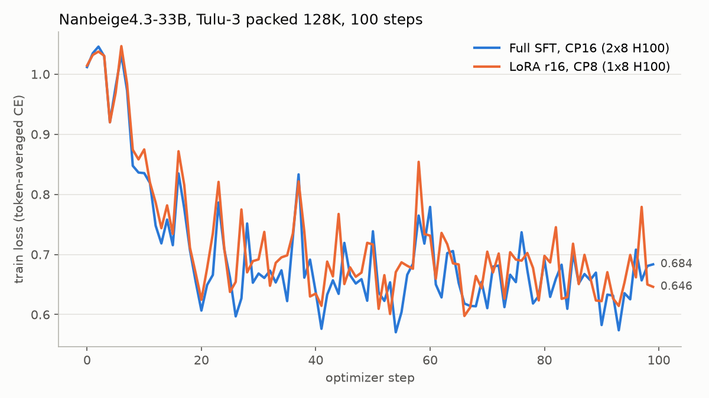

[Nanbeige4.3-33B](https://huggingface.co/Nanbeige/Nanbeige4.3-33B) is a dense
33B-parameter reasoning and agent model from Nanbeige. Its checkpoint declares
the `LlamaForCausalLM` architecture, so NeMo AutoModel loads it through the
native Llama implementation without remote code.

## Model Reference

### Model Architecture

| Property | Value |
| --- | --- |
| Task | Text generation |
| Architecture | `LlamaForCausalLM` |
| Model type | `llama` |
| Parameters | 33.1B |
| Layers | 52 |
| Hidden size | 7,168 |
| MLP intermediate size | 22,016 (SwiGLU) |
| Attention | 56 query heads, 8 key/value heads (GQA), head dimension 128 |
| Vocabulary | 166,912 |
| RoPE | default, `rope_theta` 1.2e8 |
| Maximum positions | 524,288 |
| Word embeddings | Untied |

### Available Models

- [`Nanbeige/Nanbeige4.3-33B`](https://huggingface.co/Nanbeige/Nanbeige4.3-33B)
- [`Nanbeige/Nanbeige4.3-33B-Base`](https://huggingface.co/Nanbeige/Nanbeige4.3-33B-Base)

The base checkpoint uses `rope_theta` 1e7 and 131,072 maximum positions. The
recipes below target the post-trained checkpoint.

### Chat Template

The checkpoint chat template renders every assistant turn as
`<think>\n{reasoning}\n</think>\n\n{answer}`. Tulu-3 answers have no reasoning,
so each supervised turn starts with an empty think block, which matches the
template's `enable_thinking=False` prompt. Without a system message the
template inserts the checkpoint's default system prompt. AutoModel derives
the loss mask by rendering conversation prefixes, so no custom template is
needed: each assistant turn is supervised from its `<|im_start|>assistant`
header through `<|im_end|>`, including the empty think block, and system and
user tokens are masked.

## Training Recipes

| Workflow | Recipe | Configuration |
| --- | --- | --- |
| Full-parameter SFT | [nanbeige4_3_33b_tulu3_packed128k_cp16.yaml](https://github.com/NVIDIA-NeMo/Automodel/blob/main/examples/llm_finetune/nanbeige/nanbeige4_3_33b_tulu3_packed128k_cp16.yaml) | Tulu-3 packed to 131,072 tokens, TE attention, CP16 on two 8x H100 nodes, TE FusedAdam with BF16 moments and master weights |
| LoRA | [nanbeige4_3_33b_tulu3_packed128k_cp8_lora.yaml](https://github.com/NVIDIA-NeMo/Automodel/blob/main/examples/llm_finetune/nanbeige/nanbeige4_3_33b_tulu3_packed128k_cp8_lora.yaml) | Rank-16 LoRA on every attention and MLP projection, Tulu-3 packed to 131,072 tokens, TE attention, CP8 on one 8x H100 node |

Follow the [installation instructions](/get-started/installation), then run the
LoRA recipe from the repository root:

```bash
automodel examples/llm_finetune/nanbeige/nanbeige4_3_33b_tulu3_packed128k_cp8_lora.yaml \
  --nproc-per-node 8
```

Launch the full-parameter recipe on each of two nodes:

```bash
torchrun --nnodes=2 --nproc-per-node=8 --node-rank=$NODE_RANK \
  --master-addr=$MASTER_ADDR --master-port=29500 \
  examples/llm_finetune/finetune.py \
  --config examples/llm_finetune/nanbeige/nanbeige4_3_33b_tulu3_packed128k_cp16.yaml
```

Both recipes shuffle Tulu-3 with a fixed `shuffle_seed` before packing and
keep the packed order in the dataloader. Each 131,072-token THD row stores
document boundaries in `cu_seqlens`, and position IDs restart at every
document, so TE runs block-diagonal causal attention over the pack. A global
batch is four packs, about 510K tokens.

### Training Measurements



Measured on H100 80 GB with PyTorch 2.14, Transformer Engine 2.19 and
Transformers 5.18, running each recipe for 100 steps:

| Recipe | GPUs | Tokens per rank | Step 0 loss | Mean loss, steps 90-99 | Step time | Peak memory |
| --- | --- | --- | --- | --- | --- | --- |
| Full-parameter SFT, CP16 | 2x8 H100 | 8,192 | 1.012 | 0.641 | ~27 s | 53.3 GiB |
| LoRA, CP8 | 1x8 H100 | 16,384 | 1.014 | 0.662 | ~36 s | 64.2 GiB |

These are training losses, not held-out quality measurements.

## Parallelism and Backends

- Packed THD batches run through TE attention (`backend.attn: te`). Padded
  BSHD batches use the Hugging Face attention interface.
- Context parallelism shards each packed row across the CP group. The pack
  length must be divisible by `2 * cp_size`.
- Full-parameter training does not fit 16,384 tokens per rank beside the
  sharded parameters, gradients and optimizer state on one 8x H100 node,
  so the full-parameter recipe spans two nodes with CP16. LoRA keeps the base
  weights frozen and fits CP8 on one node.

## Related Resources

- [LLM fine-tuning guide](/recipes-e2e-examples/sft-peft)
