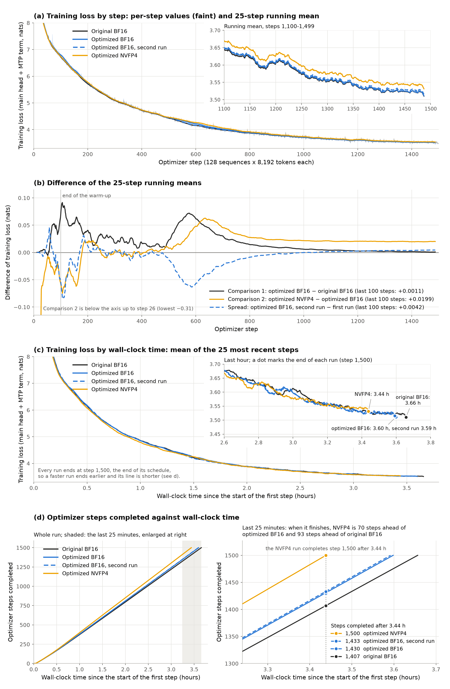

[NVIDIA-Nemotron-3.5-Super-VL-120B-A12B-BF16](https://huggingface.co/nvidia/NVIDIA-Nemotron-3.5-Super-VL-120B-A12B-BF16)
pairs a Nemotron Super NemotronH (hybrid Mamba-2 and Attention) Mixture-of-Experts (MoE) language
backbone with a RADIO v2.5-H vision encoder, sharing its `NemotronH_Omni_Reasoning_V3`
architecture and vision stack with [Nemotron-3-Nano-Omni](/model-coverage/omni/nvidia/Nemotron-3-Nano-Omni-30B-A3B-Reasoning-BF16).
The BF16 checkpoint has no audio encoder, so audio inputs are not supported.

Set up NeMo AutoModel with the [latest container](https://catalog.ngc.nvidia.com/orgs/nvidia/containers/nemo-automodel) or follow the [installation instructions](/get-started/installation).

## Fine-Tune NVIDIA-Nemotron-3.5-Super-VL-120B-A12B-BF16

From the repository root, run:

```bash
uv run automodel examples/vlm_finetune/nemotron_3_5_super_vl/nemotron_3_5_super_vl_cord_v2_peft.yaml --nproc-per-node 8
```

The Tulu-3 text recipe runs on 4 nodes:

```bash
uv run automodel examples/vlm_finetune/nemotron_3_5_super_vl/nemotron_3_5_super_vl_tulu3_text_100steps.yaml --nnodes 4 --nproc-per-node 8
```

## Choose a Workflow

| Goal | Start Here |
| --- | --- |
| Full SFT on receipt images | Follow the [CORD-v2 guide](/recipes-e2e-examples/nemotron-3-5-super-vl). |
| Text-to-SQL with LoRA | Follow the [Spider guide](/recipes-e2e-examples/nemotron-3-5-super-vl-text-to-sql). |
| Continued pretraining on raw text | Follow the [FineWeb guide](/recipes-e2e-examples/nemotron-3-5-super-vl-continued-pretraining), including Megatron data preparation. |
| NVFP4 pretraining from random initialization on 16 GB300 GPUs, `ep_size=16`; text only (vision tower frozen and unused) | Use [nemotron_3_5_super_vl_te_nvfp4_gb300.yaml](https://github.com/NVIDIA-NeMo/Automodel/blob/main/examples/llm_pretrain/nemotron_3_5_super_vl/nemotron_3_5_super_vl_te_nvfp4_gb300.yaml). Dataset: FineWeb. See [NVFP4 Pretraining on GB300](#nvfp4-pretraining-on-gb300). |
| Full SFT, text-only (vision/audio towers frozen and unused) | Use [nemotron_3_5_super_vl_tulu3_text_100steps.yaml](https://github.com/NVIDIA-NeMo/Automodel/blob/main/examples/vlm_finetune/nemotron_3_5_super_vl/nemotron_3_5_super_vl_tulu3_text_100steps.yaml). Dataset: Tulu-3. |
| 256K packed SFT on 16 GB200 GPUs, `cp_size=8` / `ep_size=16`; text-only packs (`inject_fake_images: false`) | Use [nemotron_3_5_super_vl_tulu3_packed_256k_cp8_ep16_gb200.yaml](https://github.com/NVIDIA-NeMo/Automodel/blob/main/examples/vlm_finetune/nemotron_3_5_super_vl/nemotron_3_5_super_vl_tulu3_packed_256k_cp8_ep16_gb200.yaml). Dataset: Tulu-3 (packed, THD). |
| Low-rank adaptation (LoRA) (rank 64) on the LLM linear projections, base model frozen; receipt image to structured field tokens; single node | Use [nemotron_3_5_super_vl_cord_v2_peft.yaml](https://github.com/NVIDIA-NeMo/Automodel/blob/main/examples/vlm_finetune/nemotron_3_5_super_vl/nemotron_3_5_super_vl_cord_v2_peft.yaml). Dataset: CORD-v2. |

### LoRA on CORD-v2

`nemotron_3_5_super_vl_cord_v2_peft.yaml` fine-tunes the model on CORD-v2 receipt field extraction
with LoRA adapters. Follow the [CORD-v2 guide](/recipes-e2e-examples/nemotron-3-5-super-vl) for data
preparation, training, and evaluation. Because the base weights are frozen, there are no fp32 master
weights or optimizer states for them, so the 121B model trains on a single node of 8 H100 (`cp_size 1`, `ep_size 8`) instead of the
4 nodes that full SFT needs.

| Property | Value |
| --- | --- |
| Low-rank adaptation (LoRA) targets | 272 linear projections: Mamba `in_proj`/`out_proj`, attention `q/k/v/o_proj`, MoE `fc1/fc2_latent_proj` and shared experts (routed experts, vision tower, projector, `lm_head` frozen) |
| Trainable parameters | 177M (0.15%), rank 64, alpha 128; TE `FusedAdam` with fp32 master weights, lr 2e-4 |
| Peak memory | 38.8 GiB/GPU |
| Adapter checkpoint | 355 MB (`adapter_model.safetensors` + `adapter_config.json`) |
| Training | 400 steps (global batch 8, 4 epochs of the 800 training receipts) in 13 min on one node; train loss 0.51 -> 0.01 |
| Validation loss | 0.041 / 0.039 / 0.043 / 0.040 at steps 99 / 199 / 299 / 399 |
| Field extraction (first 20 validation receipts, greedy, adapter merged into the base model) | step 199 (`LOWEST_VAL`): 8/20 exact match, mean similarity 0.954 (median 0.997), 20/20 structured outputs |

### NVFP4 Pretraining on GB300

`nemotron_3_5_super_vl_te_nvfp4_gb300.yaml` pretrains the language model from random initialization on
[FineWeb](https://huggingface.co/datasets/HuggingFaceFW/fineweb) text with Transformer Engine (TE) NVFP4 on
16 GB300 GPUs. The vision tower and projector are frozen and do not run on text batches. As written, the recipe
saves no checkpoint and has no validation set. Set `checkpoint.enabled` and add a validation dataset before a
run whose model you keep; neither was exercised with this recipe.

Precision follows the per-layer-type layout published for the model family in the
[Nemotron 3 Super technical report](https://arxiv.org/abs/2604.12374) (section 2.2). The NVFP4 pretraining
recipe is described in [arXiv:2509.25149](https://arxiv.org/abs/2509.25149). `te_nvfp4.precision_map` assigns it:

| Precision | TE GEMM modules | Modules per rank |
| --- | --- | ---: |
| NVFP4 | Mamba input projections, routed experts, and shared experts of layers 0-73 | 166 |
| MXFP8 | Mamba output projections of layers 0-73 | 34 |
| BF16 | Every GEMM of the last 14 layers; the attention projections, latent projections, and Multi-Token Prediction (MTP) head | 163 |

`lm_head` is a torch linear and stays in BF16. Parameters are BF16; TE `FusedAdam` keeps fp32 master weights
and fp32 moments. Rank 0 logs the module counts at startup.

| Property | Value |
| --- | --- |
| Hardware and software | 4 nodes with 4 GB300 GPUs each; NVFP4 needs Blackwell GPUs and TE 2.19 or newer |
| Parallelism | FSDP2, `ep_size 16`, `tp_size 1`, `cp_size 1`, `pp_size 1` |
| Batch | 128 sequences of 8,192 tokens per optimizer step, in 2 microbatches of 4 sequences per rank |
| Model | 88-layer language model with 512 routed experts and the learned gate; MTP head trained with two depths |
| Kernels | TE attention and linear layers, TE experts with one GEMM per expert, HybridEP, full-block activation checkpointing |
| Optimizer | lr 3e-4 with 100 warmup steps from 3e-5 and cosine decay to 3e-5, weight decay 0.1, gradient clipping at 1.0 |

Tokenize FineWeb with the model's tokenizer. The output path matches the recipe's `dataset.file_pattern`, and
one billion tokens cover its 900 optimizer steps:

```bash
python tools/nanogpt_data_processor.py --dataset HuggingFaceFW/fineweb --set-name sample-10BT \
  --max-tokens 1B --tokenizer nvidia/NVIDIA-Nemotron-3.5-Super-VL-120B-A12B-BF16 \
  --output-dir fineweb_nemotron_3_5_super_vl
```

Launch on each of the 4 nodes from the repository root:

```bash
torchrun --nnodes=4 --nproc-per-node=4 --rdzv-backend=c10d --rdzv-endpoint=$HEAD_NODE:29500 \
  -m nemo_automodel.cli.app \
  examples/llm_pretrain/nemotron_3_5_super_vl/nemotron_3_5_super_vl_te_nvfp4_gb300.yaml
```

The figure and tables compare the recipe with the same file without its `te_nvfp4` block (BF16), which was run
twice. All runs use the same seed, initial weights, and data order on 16 GB300 GPUs (TE 2.19.0) and train
1,500 optimizer steps, 1.57 billion tokens. Two settings differ from the recipe as written: a 1,500-step cosine
schedule (`--step_scheduler.max_steps 1500`) and 4.5 billion tokens of FineWeb `sample-10BT` in 16 shards, one
per rank, read in stored order (`--dataset.file_pattern`). Every run completed its 1,500-step schedule before
its time budget of 13,800 seconds and stopped there, so the runs are equal in steps and differ in time: a
faster run ends earlier, and its line in the wall-clock panels is shorter. "Original BF16" in the figure is
the BF16 run on the code before the Mamba and MoE optimizations that this recipe uses; it took 3.66 hours.



| Run | Optimizer steps | Mean training loss, steps 1,400-1,499 | Step time | Tokens/sec/GPU | Peak memory | Time for 1,500 steps |
| --- | ---: | ---: | ---: | ---: | ---: | ---: |
| NVFP4 (the recipe) | 1,500 | 3.541 | 7.99 s | 8,203 | 205.6 GiB/GPU | 3.44 h |
| BF16 (without `te_nvfp4`) | 1,500 | 3.521 | 8.37 s | 7,832 | 212.5 GiB/GPU | 3.60 h |
| BF16, second run | 1,500 | 3.525 | 8.35 s | 7,849 | 212.1 GiB/GPU | 3.59 h |

Step time is the median over steps 100-1,499, and peak memory is the `nvidia-smi` maximum of the busiest GPU.
Over the last 100 steps the NVFP4 loss is 0.020 (0.57%) above the BF16 loss, and the two BF16 runs differ by
0.004. NVFP4 was run once, so its own run-to-run difference is not measured.

The NVFP4 step is 4.7% faster, so the NVFP4 run finishes its 1,500 steps 9.6 minutes before the BF16 run, and
at equal wall-clock time it has completed more steps. Panel (d) of the figure shows the optimizer steps
completed against wall-clock time for the whole run and, enlarged, for the last 25 minutes. When the NVFP4 run
completed step 1,500 after 3.44 hours, it was 70 steps ahead of the BF16 run, 67 ahead of the second BF16 run,
and 93 ahead of the Original BF16 run, which had completed 1,407 steps. Time counts from the start of the
first step:

| Optimizer steps completed (mean training loss of the 50 most recent steps) after | NVFP4 (the recipe) | BF16 (without `te_nvfp4`) | BF16, second run |
| --- | ---: | ---: | ---: |
| 1 hour | 399 (4.836) | 381 (4.911) | 380 (4.910) |
| 2 hours | 851 (3.893) | 811 (3.899) | 811 (3.889) |
| 3 hours | 1,301 (3.581) | 1,241 (3.604) | 1,243 (3.607) |
| 3.44 hours, when the NVFP4 run finished | 1,500 (3.538) | 1,430 (3.530) | 1,433 (3.533) |

The learning rate follows the step, so at equal time the faster run is further down the same schedule. The
NVFP4 loss is lower after 1 hour and after 3 hours. Between 3.1 and 3.3 hours it crosses the loss of each BF16
run several times and stays within 0.011 of it, and at the moment the NVFP4 run finishes it is 0.008 above the
BF16 run. These are training losses on batches seen once, not held-out quality measurements. The learned gate
of a randomly initialized model routes tokens unevenly across ranks, so these token rates are lower than the
balanced-routing rows on mock data in the [Performance Summary](/performance/performance-summary).

## Model Reference

### Model Architecture

| Property | Value |
| --- | --- |
| Task | Multimodal (Text/Image) |
| Architecture | `NemotronH_Omni_Reasoning_V3` |
| Parameters | 121B total (MoE, 512 routed experts, 22 active per token; 124B with the MTP head) |
| Hugging Face Organization | [nvidia](https://huggingface.co/nvidia) |

- `NemotronH_Omni_Reasoning_V3` reuses the same `NemotronOmniForConditionalGeneration`
  wrapper, vision tower, and state-dict adapter as `NemotronH_Nano_Omni_Reasoning_V3`;
  only the LLM sub-config scale differs (Super compared to Nano). The `sound_encoder` and
  `sound_projection` submodules are constructed only when the checkpoint's
  `sound_config` is present, so this checkpoint loads with audio disabled.

### Available Models

- **NVIDIA-Nemotron-3.5-Super-VL-120B-A12B-BF16**: 121B total (MoE), post-trained, no audio encoder
- **[NVIDIA-Nemotron-3.5-Super-VL-120B-A12B-Base-BF16](https://huggingface.co/nvidia/NVIDIA-Nemotron-3.5-Super-VL-120B-A12B-Base-BF16)**: 121B total (MoE), pretrained only, no audio encoder

## Related Resources

- [CORD-v2 SFT and LoRA](/recipes-e2e-examples/nemotron-3-5-super-vl)
- [Text-to-SQL with LoRA](/recipes-e2e-examples/nemotron-3-5-super-vl-text-to-sql)
- [Continued Pretraining on FineWeb](/recipes-e2e-examples/nemotron-3-5-super-vl-continued-pretraining)
