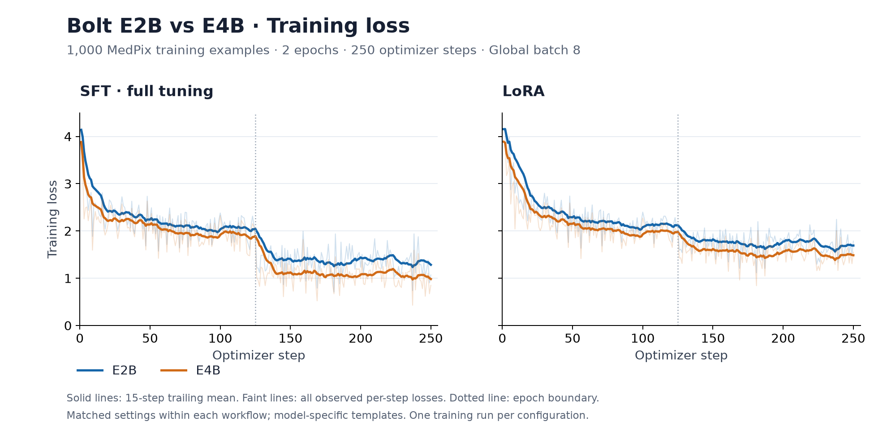
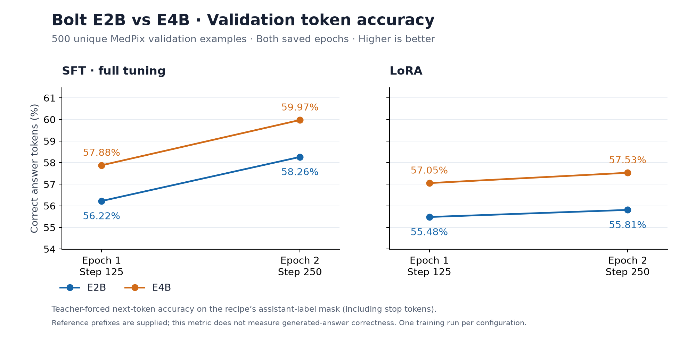

[NVIDIA-Nemotron-3.5-Bolt-E2B-BF16](https://huggingface.co/nvidia/NVIDIA-Nemotron-3.5-Bolt-E2B-BF16)
uses the registered `Gemma4ForConditionalGeneration` implementation. NeMo AutoModel provides
full-parameter and LoRA image-text fine-tuning recipes with the E2B chat template.

<Note>
The checkpoint used for onboarding was supplied as a local Hugging Face-format directory.
The Hub repository was unavailable to the inspection credential. Use an accessible local
checkpoint with both safetensors shards, the index, config, tokenizer, processor, and chat-template files.
Scheduled recipe CI remains disabled until the checkpoint is available to CI workers.
</Note>

## Fine-Tune Bolt E2B

Follow the [installation instructions](/get-started/installation). From the repository root,
set the absolute path to your local checkpoint:

```bash
export BOLT_E2B_MODEL_PATH=/path/to/Nemotron-3.5-Bolt-E2B-BF16
```

Run the LoRA recipe:

```bash
uv run automodel examples/vlm_finetune/nemotron_3_5_bolt/nemotron_3_5_bolt_e2b_peft.yaml \
  --nproc-per-node 2 \
  --model.pretrained_model_name_or_path "${BOLT_E2B_MODEL_PATH}"
```

Or run the full-parameter language-model tuning recipe with the vision and audio towers frozen:

```bash
uv run automodel examples/vlm_finetune/nemotron_3_5_bolt/nemotron_3_5_bolt_e2b.yaml \
  --nproc-per-node 8 \
  --model.pretrained_model_name_or_path "${BOLT_E2B_MODEL_PATH}"
```

The VLM recipe loads the processor from the overridden model location. The LoRA command uses two GPUs
and full tuning uses eight, following the E4B recipe layout. GPU memory requirements depend on image sizes, sequence length, and optimizer state. These commands
do not establish a minimum GPU-memory requirement.

## Choose a Workflow

| Goal | Recipe |
| --- | --- |
| LoRA on MedPix-VQA | [nemotron_3_5_bolt_e2b_peft.yaml](https://github.com/NVIDIA-NeMo/Automodel/blob/main/examples/vlm_finetune/nemotron_3_5_bolt/nemotron_3_5_bolt_e2b_peft.yaml) |
| Full-parameter language-model tuning on MedPix-VQA | [nemotron_3_5_bolt_e2b.yaml](https://github.com/NVIDIA-NeMo/Automodel/blob/main/examples/vlm_finetune/nemotron_3_5_bolt/nemotron_3_5_bolt_e2b.yaml) |

Both recipes use FSDP2, activation checkpointing, a 2,048-token limit, right padding,
and frozen vision/audio towers. Full tuning uses eager attention; LoRA uses SDPA. LoRA targets the
language model's attention and MLP projections with rank 16 and alpha 32. Full tuning keeps parameters and AdamW state in FP32 with BF16 forward compute;
LoRA loads the BF16 base weights. Other parallelism axes remain at size one.

## Checkpoint Compatibility

The inspected checkpoint records Transformers `5.5.0.dev0`; this integration uses the repository's
pinned Transformers version. Its index references two files:

- `model-00001-of-00001.safetensors`
- `model-frozen-shared-kv.safetensors`

The second file stores 60 legacy K/V projection and K-normalization tensors for shared layers 15-34.
Current Transformers omits those unused modules. Automodel's direct DCP loading requests current-model
tensors and preserves tied embeddings when `lm_head.weight` is omitted from the checkpoint.
The onboarding tests reproduce this layout and exercise export/reload using tiny models.
Keep the original index and both shards together; do not remove files from the source checkpoint.

## Prompting and Generation

The E2B template preserves assistant text before tool calls and continues the same assistant turn after
a tool response. It differs from the older checked-in E4B template in this continuation behavior.
Both datasets select the E2B template explicitly.

- `enable_thinking` defaults to false; enabling it adds the thinking instruction.
- `conversational_mode` adds a concise spoken-conversation instruction.
- Tool-call arguments must be JSON objects when passed to the template.
- Preserve generation stop IDs `[1, 106, 50]`: `<eos>`, `<turn|>`, and `<|tool_response>`.

## Validated Training and Evaluation

### Checkpoint Interoperability

The complete E2B checkpoint was compared with Hugging Face Transformers 5.18.0 on H100 80GB GPUs.
All current model weights matched exactly. Both eager and SDPA attention produced a maximum logit
difference of **0** for short text and synthetic image-text inputs processed by the real checkpoint processor.
Tiny CPU models additionally cover text/image forward and backward parity, export/reload, tied embeddings,
and rejection of missing live weights. Two-GPU training checks verified exact LoRA adapter and optimizer restoration.

### MedPix Comparison with Bolt E4B

Both E2B recipes and matched E4B comparison configurations completed **two epochs and 250 optimizer steps**
on CoreWeave H100 80GB GPUs. These measurements use a subset of
[MedPix-VQA](https://huggingface.co/datasets/mmoukouba/MedPix-VQA): `train[:1000]` and `validation[:500]`.
They are one training run per model/workflow, with training seed 42.

| Setting | SFT / full tuning | LoRA |
| --- | --- | --- |
| GPUs per training run | 8 H100 80GB | 2 H100 80GB |
| Strategy | FSDP2; activation checkpointing | FSDP2; activation checkpointing |
| Global / local batch size | 8 / 1 | 8 / 1 |
| Sequence limit / padding | 2,048 / right | 2,048 / right |
| Parameter / optimizer precision | FP32 parameters and AdamW state | BF16 base and adapters |
| Forward / reduction precision | BF16 / FP32 | BF16 / FP32 |
| Attention | Eager | SDPA |
| AdamW learning rate | `1e-5`, constant | `2e-4`, cosine decay |
| AdamW betas / weight decay | `(0.9, 0.95)` / `0.01` | `(0.9, 0.95)` / `0.01` |
| Frozen modules | Vision and audio towers | Vision/audio towers and base weights |
| Adapter targets | None | Language-layer Q/K/V/O and gate/up/down projections; rank 16, alpha 32 |

The comparison aligns precision, attention backends, activation checkpointing, sequence length, optimizer
settings, and adapter targets within each workflow. E4B comparison runs apply these settings to the E4B
recipe layout; they are not runs of its historical defaults without overrides. Full tuning has no added
cosine scheduler. Both workflows disable the Liger and SDPA patching options.

Each model uses its own checkpoint chat template with thinking disabled. E2B used the locally supplied
checkpoint. E4B used the public BF16 weights (both shards verified against the release) and public metadata
pinned to revision `49843eed8db1f1c616c47af75cfd36e07aec0667`.
The measured source snapshot was based on upstream commit `3c133c7b` plus the E2B additions; the
training-source archive SHA-256 was `a0c1c671d8116e1dffd162532a2ff6fbf7fb4349041bbaaf97e876e7cb06b603`.

### Training Loss



Solid lines show a 15-step trailing mean; faint lines retain all 250 observed losses per run.
The dotted line marks the first epoch boundary. The table below reports the raw final-step loss.
[Download all training-loss points](./bolt-e2b-e4b-training-loss.csv).

### Validation Token Accuracy

The recipes log validation loss during training. To obtain accuracy, both saved epoch checkpoints from
all four runs were reloaded and evaluated on **the same 500 unique validation examples**. No retraining
was performed. The evaluator uses the recipe processor, saved template, 2,048-token limit, and assistant-label mask.
That mask includes supervised stop tokens and excludes prompt, image, and padding positions. The collator
already shifts labels for next-token prediction; the evaluator does not shift them a second time.

**Validation token accuracy = correct top-1 next-token predictions / supervised tokens.**
All eight evaluations used identical target token IDs and **52,794 supervised tokens** each.
Reference answer prefixes are supplied during evaluation. This metric measures token prediction;
it does not assess the correctness of a freely generated answer or clinical decisions.



| Model | Workflow | Final training loss | Epoch 1 accuracy | Epoch 2 accuracy |
| --- | --- | --- | --- | --- |
| E2B | SFT / full tuning | 1.0702 | 56.22% | 58.26% |
| E4B | SFT / full tuning | 0.8503 | 57.88% | 59.97% |
| E2B | LoRA | 1.7842 | 55.48% | 55.81% |
| E4B | LoRA | 1.5512 | 57.05% | 57.53% |

At epoch 2, E4B leads by 1.71 percentage points for SFT and 1.72 percentage points for LoRA.
The curves show two observed validation points per run. These subset experiments describe these
configurations and do not establish broader model quality or minimum GPU-memory requirements.
[Download validation counts and accuracy](./bolt-e2b-e4b-validation-accuracy.csv).

As a loading check, recomputed SFT loss reproduces the original logs within `2.3e-7` after reconstructing
the original distributed sampler's four repeated examples. Original SFT validation saw 504 samples;
the accuracy evaluation scores 500 distinct samples. E2B LoRA loss differs by less than `1e-7`, and E4B
LoRA loss differs by at most `4.6e-4`. All four evaluation runs' W&B histories match the retained metrics.

### W&B Runs

The links below open the `Nemo-automodel/automodel` project and may require project access.
Training loss uses metric `loss`; the separate saved-checkpoint evaluations log
`validation/token_accuracy_percent` against `epoch`.

| Model / workflow | Training run | Checkpoint evaluation |
| --- | --- | --- |
| E2B SFT | [250-step loss history](https://forge.coreweave.com/wandb/Nemo-automodel/automodel/runs/e2b-full-22996937) | [Both epoch accuracies](https://forge.coreweave.com/wandb/Nemo-automodel/automodel/runs/e2b-full-accuracy-23059246) |
| E2B LoRA | [250-step loss history](https://forge.coreweave.com/wandb/Nemo-automodel/automodel/runs/e2b-lora-22996988) | [Both epoch accuracies](https://forge.coreweave.com/wandb/Nemo-automodel/automodel/runs/e2b-lora-accuracy-23059246) |
| E4B SFT | [250-step loss history](https://forge.coreweave.com/wandb/Nemo-automodel/automodel/runs/e4b-full-23035279) | [Both epoch accuracies](https://forge.coreweave.com/wandb/Nemo-automodel/automodel/runs/e4b-full-accuracy-23059247) |
| E4B LoRA | [250-step loss history](https://forge.coreweave.com/wandb/Nemo-automodel/automodel/runs/e4b-lora-23035280) | [Both epoch accuracies](https://forge.coreweave.com/wandb/Nemo-automodel/automodel/runs/e4b-lora-accuracy-23059247) |

To log your own training run, authenticate with W&B, then append
`--wandb.enable true --wandb.mode online --wandb.entity YOUR_ENTITY --wandb.project automodel`
to either recipe command. The recipes leave W&B disabled by default. Saved-checkpoint token accuracy
is a separate evaluation; enabling W&B alone does not add this metric to the training recipe.

## Model Reference

### Model Architecture

| Property | Value |
| --- | --- |
| Architecture | `Gemma4ForConditionalGeneration`, dense text backbone |
| Decoder layers / hidden size | 35 / 1,536 |
| Query / KV heads | 8 / 1 |
| Sliding / full-attention head dimension | 256 / 512 |
| Attention schedule | Four sliding layers followed by one full-attention layer |
| Sliding window | 512 tokens |
| Shared-KV layers | Last 20 decoder layers |
| Per-layer input width | 256 |
| MLP | GELU, double-wide in shared-KV layers |
| Vocabulary | 262,144; tied embeddings |
| Configured maximum positions | 131,072; recipes use 2,048 tokens |
| Stored precision | BF16 |

The config includes vision and audio towers. The examples configure image-text fine-tuning;
audio/video fine-tuning is outside these recipes' coverage.

## Related Resources

- [Bolt E4B](/model-coverage/vision-language-models/nvidia/NVIDIA-Nemotron-3.5-Bolt-E4B-4GB-BF16)
- [Bolt 74B](/model-coverage/vision-language-models/nvidia/NVIDIA-Nemotron-3.5-Bolt-74B-A9B-BF16)
- [Gemma 4 fine-tuning guide](/recipes-e2e-examples/gemma-4)
