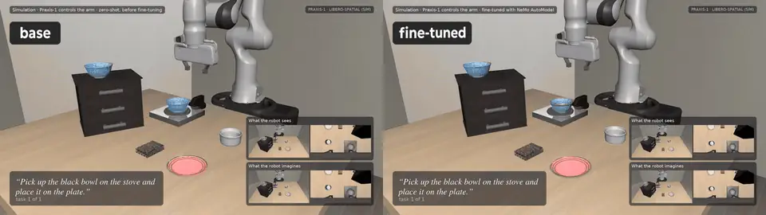
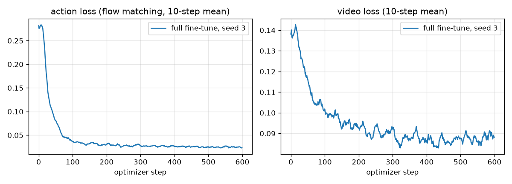
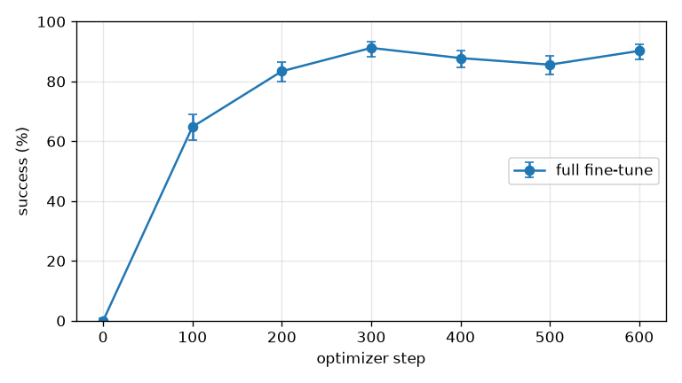

# Fine-tune Praxis-1 on LIBERO with NeMo AutoModel

Runway's Praxis-1 is a 27B world-action model trained on the real-robot DROID data. This
tutorial takes its public single-arm checkpoint, fine-tunes it with NeMo AutoModel on the
[LIBERO](https://libero-project.github.io/) benchmark's human demonstrations, and evaluates it with the
standard LIBERO protocol before and after. Every step runs from public data on one 8-GPU node.
| LIBERO-Spatial, 10 tasks x 50 standard initial states | success |
|---|---|
| base `praxis-1-droid`, zero-shot | 0/500 (0.0 %) |
| full fine-tune, 600 steps x 48 windows on 8 H100 | 451/500 (90.2 %) |
| LoRA, 600 steps x 48 windows on 8 H100 | 457/500 (91.4 %) |



Two evaluation episodes of "pick up the black bowl on the stove and place it on the plate", rendered from a display
camera: the base checkpoint, zero-shot, on the left and the fine-tuned policy on the right. The insets show the two
camera views the policy receives and the frames its video trunk predicts for the chunk it is about to execute.

## Setup

Praxis-1's video trunk predicts the next 1.6 s of both camera views and the action expert reads the
actions off that prediction, so the fine-tune trains all weights: the trunk learns the new renderer,
scenes and objects, the action expert the new controller. The policy's conventions and LIBERO's, which
the LIBERO side of the tutorial matches exactly:
| | Praxis-1 (DROID) | LIBERO (robosuite 1.4.1) |
|---|---|---|
| control | target flange poses at 15 Hz, chunks of 24 | OSC_POSE deltas at 20 Hz, at most 0.05 m / 0.5 rad per step |
| pose frame | Franka flange (DH link 8) in the robot base frame | `grip_site` 0.097 m past the hand, world frame |
| cameras | one exterior and one wrist view, 224x416 tiles | `agentview` and `robot0_eye_in_hand`, any resolution |
| gripper | 0 open .. 1 closed, continuous | -1 open / +1 close, a sign |
| frames | 93 frames (6.2 s) per training window | demonstrations of 3.8 s to 9.9 s |

The bridge between the two lives next to this README: [`libero_bridge.py`](./libero_bridge.py) (the pose,
frequency and controller conventions, and the message format of the simulator pipe),
[`libero_sim.py`](./libero_sim.py) (the simulator session and its worker process),
[`convert_libero_demos.py`](./convert_libero_demos.py), [`run_libero_eval.py`](./run_libero_eval.py) and
[`libero_results.py`](./libero_results.py). The environment, its controller and the success checks are the
unmodified LIBERO ones.

## 1. Set up the LIBERO environment and get the data

LIBERO needs robosuite 1.4 on Python 3.8-3.10, the policy container runs Python 3.12. Keep them apart: a
small virtual environment for LIBERO, and a subprocess bridge ([`libero_sim.py`](./libero_sim.py) run as a
script) that the policy process talks to over pipes (JSON headers plus raw array bytes, so the two NumPy
versions do not matter).

```bash
uv venv --python 3.10 libero/.venv
uv pip install --python libero/.venv/bin/python robosuite==1.4.1 mujoco==3.2.3 numpy==1.22.4 bddl==1.0.1 \
    gym==0.25.2 h5py imageio imageio-ffmpeg huggingface_hub torch==2.2.2 --index-url https://download.pytorch.org/whl/cpu \
    --extra-index-url https://pypi.org/simple --index-strategy unsafe-best-match
git clone https://github.com/Lifelong-Robot-Learning/LIBERO.git libero/LIBERO
echo $PWD/libero/LIBERO > libero/.venv/lib/python3.10/site-packages/libero_repo.pth
export LIBERO_PY=$PWD/libero/.venv/bin/python LIBERO_CONFIG_PATH=$PWD/libero/config MUJOCO_GL=egl
export PRAXIS_REF=<checkout of the reference runtime>   # its praxis package and configs/sim_droid.yaml
# the original demonstrations, with the simulator states (CC BY 4.0)
hf download yifengzhu-hf/LIBERO-datasets --repo-type dataset --local-dir libero/datasets --include "libero_spatial/*"
```

The model weights are named by their Hugging Face repos: `runwayml/praxis-1-droid` (the checkpoint),
`Wan-AI/Wan2.2-TI2V-5B` (the Wan2.2 VAE, `Wan2.2_VAE.pth`) and `Qwen/Qwen3.5-2B` (the text encoder). The
training configs and the scripts below download them into the Hub cache on first use; a local directory or
file works in their place.

The config directory keeps LIBERO's paths file out of `$HOME`. The evaluation script below reads these four variables.

## 2. Convert the demonstrations by re-executing them

[`convert_libero_demos.py`](./convert_libero_demos.py) turns each
HDF5 demonstration into one recorded episode in the policy's training format (the `.npz` layout that the
recipe's `EpisodeWindowDataset` reads):

1. Load the demonstration's initial simulator state, run the evaluation protocol's 10 settle steps, then
   re-execute the recorded 20 Hz actions and hold still afterwards until the episode has at least 126
   control steps (one 93-frame window at 15 Hz). Only re-executions that reach the task's success
   condition are kept.
2. Render both cameras at the policy's tile size (`video.tile_height` x `video.tile_width` of the checkpoint's
   `config.json`, 224x416 for `praxis-1-droid`) and stack them into the 224x832 canvas; the policy's own
   `tile_clip` then leaves the frames untouched (checked bit for bit).
3. Observed pose: the `robot0_right_hand` body in the robot base frame, which is the Franka flange turned
   by -45 degrees about its z axis: exactly the `TURNED_FLANGE` rig frame of the policy's simulator, so
   the policy's own frame conversion applies. Commanded pose: the goal that the OSC_POSE controller sets
   for the recorded action (current grip-site pose plus the scaled delta), mapped back to the hand.
4. Resample 20 Hz to 15 Hz with the index map `round(4k/3)`; the evaluation client samples its
   observations with the same map.

```bash
for i in 0 1 2 3 4 5 6 7; do
  CUDA_VISIBLE_DEVICES=$i MUJOCO_EGL_DEVICE_ID=$i $LIBERO_PY tutorials/praxis-1-libero/convert_libero_demos.py \
      --suite libero_spatial --out data/libero_episodes --checkpoint runwayml/praxis-1-droid --shard $i/8 &
done; wait
```
Ten tasks take about ten minutes on 8 GPUs and 10 GB of disk. 446 of the 500 demonstrations re-execute to
success and are kept. The recorded episodes have a median of 124 control steps; the re-executed end effector
tracks the dataset's own positions to 12.6 mm on average, the forward kinematics of the recorded joints
reproduces the recorded poses to 0.0 mm, and the first rendered frame differs from the stored one by 2 to 4
out of 255 (mean absolute error).

Before any training, the episode files are checked: the canvas equals `tile_clip` of the two views, the
stored flange poses equal `pose8_to_model` of the hand poses, and the 10-D proprio and relative actions
lie inside the checkpoint's DROID normalization range.

## 3. Evaluate the base checkpoint with the LIBERO protocol

[`run_libero_eval.py`](./run_libero_eval.py) runs the standard
LIBERO protocol: for every task the benchmark's 50 recorded initial states, 10 dummy
steps after `set_init_state`, the episode ends at the first success or after 220 control steps
(LIBERO-Spatial), the env seed is 7. The policy is the reference closed-loop session of
`praxis.sim.loop.ModelPolicy` with the sampler settings of `configs/sim_droid.yaml` (2 Euler steps,
text guidance 3.0, 24 rows per call, one context chunk). Every 15 Hz tick the client pushes the upright
views and the hand pose into the policy's observation stack; every 20 Hz step it tracks the
interpolated hand target of the current chunk with an OSC delta and sends the sign of the commanded grip.

```bash
python tutorials/praxis-1-libero/run_libero_eval.py --gpus 8 --suite libero_spatial \
    --checkpoint runwayml/praxis-1-droid --out eval/libero_spatial_base
```

`--gpus 8` runs eight shards at once, one model per GPU with its renderer on the next GPU, restarts a shard
that dies (the shards are resumable) and writes `summary.json` when all are done; about half an hour, because
every episode of the base checkpoint runs to the 220-step limit. A checkpoint whose config names the
flash-attention backend is evaluated through a view of it that names the triton backend (same weights, created
once next to the checkpoint), so flash-attn is not needed on the evaluation node.
The outputs have the layout of the reference `run_sim_eval.py`, so the reference's comparison tools and
the paired summary below read them unchanged.

The base checkpoint fails all 500 episodes (0/500); every one runs to the 220-step limit. It moves smoothly
and purposefully, but towards the wrong things: it heads for the stove or the cabinet and lowers the gripper
there, and never closes it on the bowl. This is the expected zero-shot picture for a model that has never seen
this renderer, these objects or this camera.

## 4. Fine-tune all weights with NeMo AutoModel

```bash
automodel examples/wam/praxis/praxis_1_libero.yaml --nproc-per-node 8
```

The recipe ([`TrainWAMFinetuneRecipe`](../../nemo_automodel/recipes/wam/train.py), configured by
[`praxis_1_libero.yaml`](../../examples/wam/praxis/praxis_1_libero.yaml)) trains all 27.2B parameters on
one 8-GPU node: bf16 weights under FSDP2, the 128 routed experts of every MoE layer expert parallel over
the 8 GPUs (16 experts per GPU, tokens exchanged through HybridEP), Transformer Engine's FusedAdam with fp32
master weights (kept as the 16 bits that bf16 drops) and fp32 moments, the MoE balance terms, 48 windows per
optimizer step (six micro-steps of one window per GPU) and on-the-fly VAE and text encoding. The learning rate
warms up to 1e-5 over 50 steps and decays to 1e-6 with a cosine schedule. One step takes 9.2 s at 58.9 GiB per
GPU, and the 600 steps take 1 h 52 min including start-up and six checkpoint saves. Expert parallelism is what
makes the fp32 optimizer state fit next to the activations on one node. The paths in the YAML (checkpoint, encoder weights, episodes,
`checkpoint.checkpoint_dir`) are relative to the working directory; override any of them on the command line,
e.g. `--dataset.root data/libero_episodes/libero_spatial`. Every 100 steps the recipe saves
`runs/libero_spatial_fullft/epoch_0_step_<N-1>/model`: the sharded weights and, in `consolidated/`, a
checkpoint in the reference layout that the runtime loads as it is (51 GB), next to the optimizer state
(254 GB), the data-loader state and the RNG state. Set `step_scheduler.ckpt_every_steps` to the run length if the intermediate checkpoints are not wanted.



Both terms of the loss fall for the whole run (10-step means): the action loss from 0.28 to 0.023 and
the video loss from 0.138 to 0.088. The action loss starts high, because the targets of a new controller in a
new world are far from the prior, and most of its drop happens in the first 50 steps; the video term is the
trunk learning the renderer, the scenes and the objects.

## 5. Evaluate after and compare pairwise

```bash
python tutorials/praxis-1-libero/run_libero_eval.py --gpus 8 --suite libero_spatial \
    --checkpoint runs/libero_spatial_fullft/epoch_0_step_599/model/consolidated --out eval/libero_spatial_fullft_600
python tutorials/praxis-1-libero/libero_results.py summarize eval/libero_spatial_base eval/libero_spatial_fullft_600
```
Same protocol, same 500 initial states: 451/500 (90.2 %) against 0/500 for the base checkpoint. Paired over
the 500 episodes: won 451, lost 0, exact McNemar p < 1e-4, difference +90.2 points (95 % CI ±2.6). The
successful episodes end after a median of 116 control steps (5.8 s of robot time); all 49 failures run to the
220-step limit, 12 of them on "bowl on the stove". The evaluation took 19 minutes on 8 GPUs, because
successful episodes stop early.

### Learning curve

The run saved a checkpoint every 100 steps; each one was evaluated with the same protocol, one pass over the
500 episodes ([`libero_results.py curve`](./libero_results.py) draws the figure):

```bash
for s in 100 200 300 400 500; do
  python tutorials/praxis-1-libero/run_libero_eval.py --gpus 8 --suite libero_spatial \
      --checkpoint runs/libero_spatial_fullft/epoch_0_step_$((s - 1))/model/consolidated --out eval/libero_spatial_fullft_$s
done
python tutorials/praxis-1-libero/libero_results.py curve --expect-episodes 500 --point 0=eval/libero_spatial_base \
    --point 100=eval/libero_spatial_fullft_100 --point 200=eval/libero_spatial_fullft_200 --point 300=eval/libero_spatial_fullft_300 \
    --point 400=eval/libero_spatial_fullft_400 --point 500=eval/libero_spatial_fullft_500 --point 600=eval/libero_spatial_fullft_600 \
    --out tutorials/praxis-1-libero/learning_curve.png
```



Nearly two thirds of the episodes succeed after 100 steps (15 minutes of training) and 83 % after 200; from
step 300 on the curve is flat within its noise.

## 6. LoRA instead of all weights

[`praxis_1_libero_lora.yaml`](../../examples/wam/praxis/praxis_1_libero_lora.yaml) trains LoRA adapters for
600 steps x 48 windows with the base weights frozen.

```bash
automodel examples/wam/praxis/praxis_1_libero_lora.yaml --nproc-per-node 8
python -m nemo_automodel.components.models.praxis.lora_export --checkpoint runwayml/praxis-1-droid \
    --adapters runs/libero_spatial_lora/epoch_0_step_599/model --out runs/libero_spatial_lora/merged_600
python tutorials/praxis-1-libero/run_libero_eval.py --gpus 8 --suite libero_spatial \
    --checkpoint runs/libero_spatial_lora/merged_600 --out eval/libero_spatial_lora_600
```

The checkpointer saves the adapters; `lora_export` folds them into the base weights and writes a checkpoint the
reference runtime loads. The merged policy scores 457/500 (91.4 %) on the 500 LIBERO-Spatial episodes.
